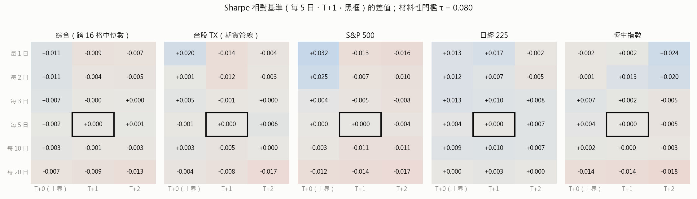
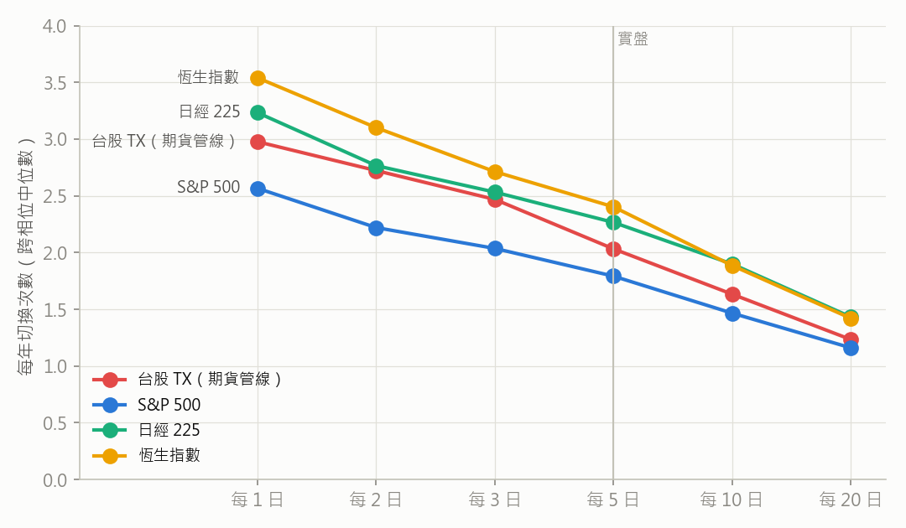

# D_10 訊號檢查頻率與執行時點的穩健性驗證（第六輪）

> 本報告開頭原文複製預先承諾規則。規則於 2026-11-05 跑出任何變體之前寫定於 `params.PRE_REGISTRATION`，並先 push 到 claude-notes 留下時間戳（`journal/2026-11-05-台指D10-訊號檢查頻率與執行時點-預先承諾.md`）；程式機械化計算判定，不因結果修改。

## 0. 任務性質

D_10 有兩個從未被檢驗的時序設定：

- **每 5 個交易日檢查一次訊號**（TREND_CHECK=5）：第三輪規格寫定，第四、五輪報告明列「未掃」。
- **訊號日收盤定案、次一交易日收盤執行**（T+1）：這是避免 look-ahead 的回測口徑，不是比較出來的。

第三輪只證明「200MA、1%、5 日、T+1」這組設定整體勝過其他策略類型，
沒有證明 5 日或 T+1 優於它們自己的變體。

> **本輪目的是「驗證 5 日檢查與 T+1 是否坐在高原上」，不是「找出最佳檢查頻率或執行時點」。**
> 所有設計都服務於前者，任何導向後者的做法都是本輪的失敗。

## 1. 設計（跑結果前寫定）

**掃描維度**：檢查頻率 K ∈ {1, 2, 3, 5, 10, 20}、執行延遲 lag ∈ {0, 1, 2}、
相位 φ ∈ {0, …, K−1}（共 41 × 3 = 123 個變體）。其餘全部凍結：MA=200、buffer=1%、
L=2.0/1.0、成本、融資、滾動視窗（四市場 TX_FUT／SPX／NKX／HSI × 3/5/10/20 年 = 16 格）。

**資料凍結**在與前五輪相同的 repo 快取（TX 至 2026-07-14），不更新。

**lag=0 不是可實現的績效。** 訊號用的結算價 13:45 後才有，無法以該價成交；lag=0 含 look-ahead，
只作「當天降槓桿」的**樂觀上界**。實際可行的做法（13:20 當場、當晚夜盤、次日開盤）都介於
lag=0 與 lag=1 之間，所以上界沒有實質改善就足以一併排除它們。

**判定量**（一律用原始 Sharpe，不用百分位，避免第四輪的量化陷阱）：

- `S(K,lag,c)`：格 c 內，該 (K,lag) 各相位「滾動視窗 Sharpe 中位數」的中位數（相位中性）。
- `Δ(K,lag,c) = S(K,lag,c) − S(5,1,c)`。
- `D(K,lag)`：Δ 跨 16 格的中位數。
- `M(K,lag)`：Δ 的逐市場中位數（跨 4 個期間）大於 0 的市場數（0–4）。
- `N`：相位雜訊＝ K=5、lag=1 時，每格 5 個相位 Sharpe 的全距，跨 16 格取中位數。
- **`τ = max(0.08, N)`**：材料性門檻。換相位就能造成的差異，不得算作換頻率的效果。

## 2. 🔴 預先承諾的決策規則

**以下規則在跑出任何結果之前即已寫定，不得因結果而修改。**

### 規則 A：檢查頻率（lag=1）
`R_A = max_K D(K,1) − min_K D(K,1)`（含 D(5,1)=0）：

- **R_A < τ** → **高原。維持 K=5。** 結論寫成「對檢查頻率不敏感」，
  **不得**因為某個 K 的數字較高就建議改用它。
- **R_A ≥ τ 且 K=5 在 6 個 K 中排名前 3** → **傾斜高原。維持 K=5**，報告說明傾斜方向與量級。
- **R_A ≥ τ 且 K=5 排名後 3** → **5 日為劣位。此時且僅此時**才討論替代。替代者必須同時滿足：
  (i) D(K*,1) ≥ τ；(ii) M(K*,1) ≥ 3；(iii) 至少一個相鄰 K 的 D ≥ 0（平原，不是孤峰）；
  (iv) 配對 bootstrap 同號市場數 ≥ 3；(v) 破產路徑數不高於基準。
  無人滿足 → 改判「傾斜但無可行替代」，維持 K=5。

### 規則 B：執行時點（上界）
`U = max(D(5,0), D(1,0))`，取到 U 的變體記為 v*：

- **U < τ** → **排除。** 連含 look-ahead 的上界都沒有實質改善，所有介於 lag=0 與 lag=1 之間的
  可行做法（13:20 當場、當晚夜盤、次日開盤）一併排除。維持 T+1。
- **U ≥ τ 且 M(v*) ≥ 3 且配對 bootstrap 同號市場數 ≥ 3** → **上界有空間。**
  **不得建議改動**：上界不是可實現績效。結論只能是「值得用可執行的資料另開一輪驗證」。
- **其他情況** → **不一致。維持 T+1**，報告寫出矛盾。

另報告 `D(5,2)`：若 ≤ −τ，記為「延遲敏感」——這是維運風險（漏跑一天的代價），不是策略改動。

### 規則 C：尖峰否決
`D(5,1) − max(D(3,1), D(10,1)) > τ` → 判定 K=5 為孤峰，報告須明確寫出
「5 日檢查的歷史績效不可信」。「贏太多」和「輸」一樣是壞消息。

### 規則 D：實盤相位運氣（只看 TX_FUT）
`ΔP`＝TX_FUT 四個期間上，`Sharpe(K=5,lag=1,φ=0) − 該格 5 相位中位數` 的中位數。
**|ΔP| ≥ τ** → 揭露「實盤相位的歷史績效受相位影響」，並標明幸運或不幸。
**禁止因此更換相位**：相位不是可選參數，換到歷史最好的相位就是過擬合。

### 規則 E：禁止事項
- 禁止輸出「建議採用 K=X」或「建議改成當天執行」，除非規則 A 第三分支的全部條件成立。
- 禁止 per-market 選擇不同的 K 或 lag；禁止以台股表現單獨下結論。
- 禁止挑選相位。
- 禁止把 lag=0 的數字寫成可實現績效。
- 本輪任何結論都**不直接改動實盤**。改動要另開 PR、同步 signals.py／regime.py 與黃金測試基準，
  並由使用者明確決定。

## 3. 第二個獨立檢查：配對 bootstrap

沿用第三輪設定（stationary bootstrap、期望區塊 60 日、1000 條 × 20 年），同一組路徑跑所有
比較變體（相位固定 0，區塊重抽本身已打亂相位）。逐市場計算路徑內配對差的中位數。

🔴 bootstrap 打斷長週期自相關，對趨勢策略有向下偏誤。因此**只用方向、只能降級不能升級**：
規則 A 的替代與規則 B 的「上界有空間」需要它同意；它不能單獨促成任何改動。

## 4. 描述性輸出（不進判定）

K×lag 熱力圖；逐市場 Δ；**平均槓桿**、CAGR、每單位槓桿 CAGR、MDD、破產路徑數；
切換次數、假訊號率、成本占比；壓力窗口；第三輪 cohort 的 maximin 百分位（交叉檢查）。
匯總值與逐市場不一致時兩者都寫。

---

## 判定摘要（機械化結果）

| 項目 | 判定量 | 結果 |
|---|---|---|
| 材料性門檻 | N（相位雜訊）= 0.045 | **τ = 0.080** |
| 規則 A：檢查頻率 | R_A = 0.009；K=5 排名第 1／6（5 > 3 > 10 > 2 > 1 > 20） | **高原** |
| 規則 B：執行時點 | U = +0.011（每 1 日、T+0（上界）） | **排除** |
| 規則 B 附帶：多延遲一天 | D(5,2) = +0.001 | 未達 −τ |
| 規則 C：尖峰否決 | D(5,1) − max(D(3,1), D(10,1)) = +0.000 | 未觸發 |
| 規則 D：實盤相位 | ΔP = -0.017（TX_FUT） | 未達 τ |

- 規則 A：R_A < τ → 高原，維持 K=5。結論：對檢查頻率不敏感。
- 規則 B：U < τ → 連含 look-ahead 的上界都沒有實質改善，可行的當天做法一併排除，維持 T+1。
- 整合檢核：K=5、lag=1、φ=0 復現第三輪凍結輸出的 D_10，16 格最大差異
  5.6e-17。資料凍結在 repo 快取，與前五輪相同。

## 1. 檢查頻率（lag=1）

所有數字都是跨相位中位數。逐市場欄為該市場四個期間 Δ 的中位數。

| 變體 | D | M（正向市場） | TX_FUT | SPX | NKX | HSI | 單格最低 | 單格最高 | 平均槓桿 | ΔCAGR（配對） | CAGR／槓桿 | ΔMDD（配對） | 成本占比 | 破產路徑 |
|---|---|---|---|---|---|---|---|---|---|---|---|---|---|---|
| 每 1 日、T+1 | -0.009 | 2 | -0.014 | -0.013 | +0.017 | +0.002 | -0.034 | +0.020 | 1.649 | -0.20pp | 8.0% | +0.14pp | 3.3% | 0 |
| 每 2 日、T+1 | -0.004 | 2 | -0.012 | -0.007 | +0.007 | +0.013 | -0.023 | +0.022 | 1.650 | +0.09pp | 8.0% | +0.06pp | 3.0% | 0 |
| 每 3 日、T+1 | -0.000 | 2 | -0.001 | -0.005 | +0.010 | +0.002 | -0.012 | +0.022 | 1.654 | +0.03pp | 8.1% | -0.00pp | 2.8% | 0 |
| 每 5 日、T+1 | +0.000 | 0 | +0.000 | +0.000 | +0.000 | +0.000 | +0.000 | +0.000 | 1.650 | +0.00pp | 8.0% | +0.00pp | 2.6% | 0 |
| 每 10 日、T+1 | -0.001 | 1 | -0.005 | -0.011 | +0.010 | -0.000 | -0.022 | +0.023 | 1.655 | -0.07pp | 8.4% | -0.08pp | 2.4% | 0 |
| 每 20 日、T+1 | -0.009 | 1 | -0.008 | -0.014 | +0.003 | -0.014 | -0.034 | +0.022 | 1.659 | -0.24pp | 8.1% | -1.00pp | 2.1% | 0 |

## 2. 執行時點

🔴 T+0 含 look-ahead，**不是可實現績效**，只作上界。實際可行的當天做法都介於 T+0 與 T+1 之間。

| 變體 | D | M（正向市場） | TX_FUT | SPX | NKX | HSI | 單格最低 | 單格最高 | 平均槓桿 | ΔCAGR（配對） | CAGR／槓桿 | ΔMDD（配對） | 成本占比 | 破產路徑 |
|---|---|---|---|---|---|---|---|---|---|---|---|---|---|---|
| 每 5 日、T+0（上界） | +0.002 | 3 | -0.001 | +0.000 | +0.004 | +0.004 | -0.020 | +0.015 | 1.649 | +0.07pp | 8.1% | +0.00pp | 2.6% | 0 |
| 每 5 日、T+1 | +0.000 | 0 | +0.000 | +0.000 | +0.000 | +0.000 | +0.000 | +0.000 | 1.650 | +0.00pp | 8.0% | +0.00pp | 2.6% | 0 |
| 每 5 日、T+2 | +0.001 | 2 | +0.006 | -0.004 | +0.007 | -0.005 | -0.015 | +0.016 | 1.651 | +0.22pp | 8.2% | -0.34pp | 2.6% | 0 |
| 每 1 日、T+0（上界） | +0.011 | 3 | +0.020 | +0.032 | +0.013 | -0.002 | -0.016 | +0.058 | 1.650 | +0.24pp | 8.2% | +0.59pp | 3.3% | 0 |
| 每 1 日、T+1 | -0.009 | 2 | -0.014 | -0.013 | +0.017 | +0.002 | -0.034 | +0.020 | 1.649 | -0.20pp | 8.0% | +0.14pp | 3.3% | 0 |
| 每 1 日、T+2 | -0.007 | 1 | -0.004 | -0.016 | -0.002 | +0.024 | -0.028 | +0.036 | 1.649 | +0.22pp | 8.5% | -0.33pp | 3.3% | 0 |

**獨立手算覆核（不經引擎）**：T+0 與 T+1 的曝險只在切換日隔天不同，差＝ΔL × 隔天報酬。
把差加總年化再除以策略波動，得到 T+0 的 Sharpe 優勢量級；最後一欄是同口徑（相位 0、全樣本單一路徑、含成本）
的引擎結果，兩者對得上才算覆核通過。
切換日隔天的平均報酬不大，是 T+0 沒有優勢的原因：訊號日當天的跌幅已經實現，少掉的只是隔天那一天的曝險。

下表是單一相位，所以 TX_FUT 的 +0.021 不能單獨看。TX_FUT 全樣本 5 個相位的 T+0 優勢依序是
+0.021、-0.011、+0.013、-0.003、-0.019，中位數 -0.003：**正負由相位決定**，實盤相位剛好是最高的。

| 市場 | K | 切換次數 | 降槓桿隔天平均報酬 | 升槓桿隔天平均報酬 | T+0 年化差 | 策略波動 | 手算 Sharpe 差 | 引擎 Sharpe 差 |
|---|---|---|---|---|---|---|---|---|
| SPX | 5 | 176 | +0.19% | +0.08% | -0.11pp | 28.8% | -0.004 | -0.002 |
| SPX | 1 | 252 | +0.05% | +0.35% | +0.38pp | 28.3% | +0.013 | +0.020 |
| NKX | 5 | 142 | +0.00% | -0.03% | -0.04pp | 30.8% | -0.001 | +0.005 |
| NKX | 1 | 194 | +0.24% | +0.04% | -0.32pp | 30.4% | -0.011 | -0.003 |
| HSI | 5 | 99 | -0.06% | +0.08% | +0.18pp | 39.3% | +0.005 | +0.004 |
| HSI | 1 | 137 | -0.14% | -0.24% | -0.17pp | 39.0% | -0.004 | -0.003 |
| TX_FUT | 5 | 54 | -0.30% | +0.45% | +0.74pp | 37.8% | +0.020 | +0.021 |
| TX_FUT | 1 | 82 | -0.23% | +0.47% | +1.05pp | 37.7% | +0.028 | +0.032 |

## 3. K × lag 全表

## 4. 相位：換一個起算日差多少

K=5、lag=1 時，同一格 5 個相位的 Sharpe 全距中位數 N = 0.045，
最大 0.066（HSI×10y）。
這個差異不含任何規則上的意義，只是檢查日剛好落在哪幾天。

實盤相位（TX_FUT，t 自 1998-07-22 起算）相對 5 相位中位數的 ΔP = -0.017。
相位不是可選參數：其他市場的相位彼此不可比，也禁止因此更換。

## 5. 配對 bootstrap（第二個檢查，只用方向）

格內為路徑內配對 Sharpe 差的中位數（變體 − 基準）。🔴 bootstrap 打斷長週期自相關，對趨勢策略有向下偏誤，只能降級不能升級。

| 變體 | TX_FUT | SPX | NKX | HSI | 同向市場數（>0） | 勝過基準的路徑比（市場中位數） | 最高歸零機率 |
|---|---|---|---|---|---|---|---|
| 每 1 日、T+1 | +0.006 | +0.005 | -0.001 | +0.001 | 3 | 53.4% | 0.0% |
| 每 2 日、T+1 | +0.005 | +0.005 | +0.001 | +0.003 | 4 | 55.6% | 0.0% |
| 每 3 日、T+1 | +0.001 | +0.003 | +0.002 | +0.003 | 4 | 53.0% | 0.0% |
| 每 5 日、T+1 | +0.000 | +0.000 | +0.000 | +0.000 | 0 | 0.0% | 0.0% |
| 每 10 日、T+1 | -0.004 | -0.006 | -0.001 | -0.006 | 0 | 41.5% | 0.0% |
| 每 20 日、T+1 | -0.013 | -0.015 | -0.006 | -0.016 | 0 | 35.6% | 0.0% |
| 每 5 日、T+0（上界） | +0.001 | +0.002 | -0.001 | +0.002 | 3 | 53.8% | 0.0% |
| 每 1 日、T+0（上界） | +0.005 | +0.007 | -0.001 | +0.008 | 3 | 57.1% | 0.0% |
| 每 5 日、T+2 | -0.003 | -0.003 | +0.001 | -0.001 | 1 | 45.5% | 0.0% |

## 6. 切換頻率與假訊號（機制來源）

每年切換次數（跨相位中位數）；假訊號＝被兩次切換夾住且持續 ≤20 個交易日的 regime 段。

| K | TX_FUT | SPX | NKX | HSI | 假訊號率（市場中位數） |
|---|---|---|---|---|---|
| 1 | 2.98 | 2.57 | 3.23 | 3.54 | 47.6% |
| 2 | 2.72 | 2.22 | 2.77 | 3.10 | 43.1% |
| 3 | 2.47 | 2.04 | 2.53 | 2.71 | 37.1% |
| 5 | 2.03 | 1.79 | 2.27 | 2.40 | 34.1% |
| 10 | 1.63 | 1.47 | 1.90 | 1.89 | 24.9% |
| 20 | 1.23 | 1.16 | 1.43 | 1.42 | 14.1% |

## 7. 壓力窗口（描述性，不進判定）

各行以「每 5 日、T+1」為基準，Δ 為變體減基準，皆跨相位中位數。每個窗口只有一條路徑，屬敘述性證據。

| 窗口 | 市場 | 基準報酬 | 基準 MDD | 每日檢查 Δ報酬 | 每日檢查 ΔMDD | 每 20 日 Δ報酬 | 每 20 日 ΔMDD | 5 日 T+0 Δ報酬 | 5 日 T+0 ΔMDD | 每日 T+0 Δ報酬 | 每日 T+0 ΔMDD |
|---|---|---|---|---|---|---|---|---|---|---|---|
| 日經1990–2003 長陰跌 | NKX | -87.6% | -88.0% | 1.5% | 1.5% | -1.3% | -1.3% | 0.5% | 0.4% | -0.0% | -0.0% |
| 2000–02 網路泡沫 | SPX | -55.3% | -55.3% | -1.2% | -1.2% | 0.2% | 0.2% | -0.3% | -0.3% | -1.9% | -1.9% |
| 2008 金融海嘯 | TX_FUT | -54.7% | -69.8% | -1.5% | 0.1% | -0.0% | -0.0% | -0.7% | -0.0% | -1.4% | 0.1% |
| 2008 金融海嘯 | SPX | -50.1% | -59.8% | -1.3% | -1.0% | 0.2% | 0.2% | -0.1% | -0.1% | -0.1% | -0.1% |
| 2008 金融海嘯 | NKX | -50.9% | -59.0% | 0.0% | 0.0% | 0.0% | 0.0% | 0.0% | 0.0% | 0.0% | 0.0% |
| 2008 金融海嘯 | HSI | -58.7% | -75.4% | -4.9% | -2.9% | -0.4% | -0.3% | -3.0% | -1.8% | -4.3% | -2.5% |
| 2020 COVID 急跌V反 | TX_FUT | 46.8% | -46.1% | 13.1% | 4.5% | -6.7% | -7.3% | 5.9% | 2.5% | 16.4% | 7.6% |
| 2020 COVID 急跌V反 | SPX | 29.1% | -42.6% | -9.6% | -3.8% | -26.2% | -13.0% | -0.9% | 0.0% | -10.8% | -4.3% |
| 2020 COVID 急跌V反 | NKX | 29.0% | -39.7% | -0.6% | 0.0% | -15.5% | -9.5% | -0.0% | 0.0% | -2.7% | 2.5% |
| 2020 COVID 急跌V反 | HSI | -7.5% | -34.2% | 1.9% | 0.3% | -3.2% | -0.8% | 1.3% | 0.0% | 2.7% | 1.8% |
| 2022 緩跌 | TX_FUT | -23.4% | -34.0% | -1.5% | -1.3% | 0.1% | 0.1% | -1.3% | -1.1% | -4.0% | -3.4% |
| 2022 緩跌 | SPX | -30.6% | -36.3% | 0.6% | 0.5% | 2.6% | 2.4% | -0.2% | -0.2% | 0.8% | 0.8% |
| 2022 緩跌 | NKX | -22.4% | -23.9% | -1.1% | -1.0% | 3.4% | 2.0% | 1.7% | 0.3% | 1.9% | 0.5% |
| 2022 緩跌 | HSI | -12.4% | -39.5% | 0.1% | 0.0% | 0.0% | 0.0% | 0.0% | 0.0% | -0.6% | 0.0% |

## 8. maximin 百分位（交叉檢查，不進判定）

第三輪 cohort 10 成員，百分位量化到 0.1 級距（§7 量化陷阱），只看是否與原始 Sharpe 矛盾。

| 變體 | 最差格百分位 | 平均百分位 |
|---|---|---|
| 每 1 日、T+0（上界） | 0.500 | 0.762 |
| 每 2 日、T+0（上界） | 0.500 | 0.725 |
| 每 3 日、T+0（上界） | 0.400 | 0.738 |
| 每 5 日、T+0（上界） | 0.400 | 0.719 |
| 每 10 日、T+0（上界） | 0.500 | 0.719 |
| 每 20 日、T+0（上界） | 0.300 | 0.650 |
| 每 1 日、T+1 | 0.400 | 0.650 |
| 每 2 日、T+1 | 0.400 | 0.700 |
| 每 3 日、T+1 | 0.500 | 0.719 |
| 每 5 日、T+1 | 0.500 | 0.713 |
| 每 10 日、T+1 | 0.500 | 0.694 |
| 每 20 日、T+1 | 0.300 | 0.650 |
| 每 1 日、T+2 | 0.400 | 0.681 |
| 每 2 日、T+2 | 0.400 | 0.713 |
| 每 3 日、T+2 | 0.300 | 0.662 |
| 每 5 日、T+2 | 0.400 | 0.719 |
| 每 10 日、T+2 | 0.500 | 0.681 |
| 每 20 日、T+2 | 0.300 | 0.606 |

## 9. 結論

1. **每 5 日檢查有被驗證嗎？** 規則 A 判定「高原」。R_A < τ → 高原，維持 K=5。結論：對檢查頻率不敏感。
   R_A = 0.009，遠低於 τ = 0.080；單格最大差異 0.058，也沒有任何一格到 τ，
   不是正負抵銷出來的平坦。**K=5 排名第 1 沒有意義**：它和後面幾名只差千分位，
   本輪不支持「5 日最好」，只支持「5 日和其他頻率一樣好」。
2. **當天就降槓桿比較好嗎？** 規則 B 判定「排除」。U < τ → 連含 look-ahead 的上界都沒有實質改善，可行的當天做法一併排除，維持 T+1。
   另一個雜訊的跡象：T+2 的配對 ΔCAGR +0.22pp 反而高於 T+1，延遲越久不是越差。
3. **為什麼這麼平？** 檢查越頻繁反應越快，但假訊號也越多，兩者抵銷：
   TX_FUT 每日檢查每年切換 2.98 次、每 5 日 2.03 次；
   假訊號率（市場中位數）47.6% 對 34.1%。
4. **慢的一端不是沒有代價**：K=20 的 Sharpe 只差 -0.009，但配對 ΔMDD -1.00pp；
   2020 年 SPX、NKX 的回撤多 9–13pp（§7）。Sharpe 高原不代表尾部也平，這是判定量的盲點，不是 K=20 可用的證據。
   快的一端則方向不一：2020 年每日檢查在 TX_FUT 較好、在 SPX 較差。
5. **對實盤的影響：** 無。
   依規則 E，本輪不輸出參數建議；任何改動都要另開 PR、同步 signals.py／regime.py 與黃金測試基準，
   並由使用者明確決定。相位也不得更換。

## 10. 誠實揭露

- **樣本與 self-selection**：四個市場是自選的，期間都結束於今天；Sharpe 中位數來自高度重疊的滾動視窗，
  獨立樣本遠少於視窗數。本輪沒有算 p 值，判定只靠事先寫定的門檻與方向一致性。
- **判定量看的是平均行為**：Sharpe 中位數會把少數快速崩跌平均掉，D 小不代表尾部沒差。
  壓力窗口（§7）是描述性輸出，不進判定，這是這個設計的已知盲點。
- **緩衝帶沒有跟著掃**：1% 是在 K=5 下檢驗的。K 改變時最適緩衝帶可能不同，本輪固定 1%；
  結論只適用於「K 或 lag 單獨改變」，不適用於同時重調緩衝帶。
- **成本口徑**：TX 用大台明細成本（手續費、期交稅、1 檔滑價），海外 5bp，實盤是微台，
  每口成本占名目的比例較高。頻率高的變體成本可能被低估。
- **T+0 只是上界**：同一個收盤既算訊號又成交，實務做不到。13:20 當場執行還要承受「13:20 價不等於結算價」
  的訊號誤差，本輪沒有分鐘資料可以量測。
- **bootstrap 對趨勢的向下偏誤**：只用方向、只能降級。
- **資料凍結**：至 2026-07，未含 2026-11 這波下跌。
- **實盤的整數口數不在模型裡**：回測是連續曝險；實盤 L=1 只能買到整數口。
- **跑結果後才加的描述欄**：配對 ΔMDD／ΔCAGR、單格最高最低、手算覆核都是看到結果後補的，只用來檢查判定是否可信，
  不進判定。起因是兩個 MDD 中位數相減得出 5.5pp，實際逐格配對只有 0.6pp：16 格的中位數剛好落在排序斷層。

## 附錄：輸出檔案

| 檔案 | 內容 |
|---|---|
| `r6_summary.csv` | 每 (K, lag) 的 D、M、逐市場 Δ 與曝險欄 |
| `r6_deltas.csv` | 每 (K, lag, 格) 的 Δ |
| `r6_variants.csv` | 123 變體 × 16 格完整指標 |
| `r6_phase_noise.csv` | 每格相位全距 |
| `r6_bootstrap.csv` | 配對 bootstrap |
| `r6_regime.csv` | 切換統計 |
| `r6_stress.csv` | 壓力窗口 |
| `r6_maximin_crosscheck.csv` | maximin 百分位交叉檢查 |
| `r6_repro_check.csv` | 復現第三輪 D_10 的檢核 |
| `r6_ruleA_candidates.csv` | 規則 A 替代條件（僅第三分支有內容） |
