# 台指期 2 倍槓桿・門檻式再平衡 [X, Y] 網格回測報告

資料：TX 逐合約每日結算價 1998-07-22 ～ 2026-07-13（6,942 個交易日、334 次轉倉）；網格 10×10 = 100 組、期間 1, 3, 5, 10, 20 年，各期間含季頻滾動起點多路徑檢驗。

## 1. 方法與口徑（重要假設一次列清）

- **連續合約**：逐合約法（日報酬只在同一口合約內部計算）為主，
  比值還原法（back-adjustment）互驗，兩法日報酬最大差異 **2.2e-16**（< 1e-8 通過）。
  持倉合約當日無價而以前值遞補的天數：0 天。
  採比值而非加減還原：加減法保點差但扭曲報酬率分母；比值還原與逐合約法在數學上恆等。
- **假跳空**：已消除。若天真拼接近月序列（把跨合約 K 棒當日報酬），此樣本會**年化偏差 -3.4%**
  ——台指期長期以**逆價差**為主（334 次轉倉的月差中位數 -0.18%／次），
  與規格假設的正價差方向相反，但無論方向皆屬系統性偏誤，必須消除。
- **carry 內生**：逆價差收斂的正 carry 已自動反映在期貨日報酬中，不另外補貼／扣除（不重複計算）。
  月差金額記錄於 `roll_events.csv` 供稽核。
- **轉倉**：近月最後交易日（實際行事曆：97.3% 的合約最後交易日恰為第三個週三，
  其餘為假日順延／颱風休市）往前推 5 個交易日，收盤執行，兩腳計成本，不改變曝險。
- **計息口徑**：對**閒置現金**計息（純期貨的實際現金流）：權益全額以現金存放，
  對日初權益按 1.7% 年化、日頻複利計息；不對借款計息。
- **每日順序**：結算 → 計息 → 破產檢查 → 轉倉 → 重算槓桿 → 門檻再平衡（收盤觸價）→ 記錄。
- **成本**：手續費 20 元/口/邊＋期交稅 0.00200%/邊＋滑價 1 檔/邊（1 檔=200 元），
  口數為連續小數，成本**即時扣入權益**（含建倉成本）。
- **破產**：權益 ≤ 0 即歸零且不得反彈；**任何一條路徑破產的參數組一律不得列入最佳解**。
- **最佳解判定**：以**跨路徑（季頻滾動起點）中位數**為準；單一路徑最大值僅作過擬合對照。

## 2. 最佳解表（每期間 × 報酬最高 / Sharpe 最高）

### 1 年期（109 條路徑；無參數組破產）

**跨路徑統計（最佳解判定依據）**

| 策略 | 中位數報酬 | 中位數Sharpe | Sharpe P25/P75 | 中位數MDD | 最差路徑報酬 | 勝率vs BH2x | 勝率vs 每日2x | 破產路徑 |
|---|---|---|---|---|---|---|---|---|
| 報酬最佳 [3.5, 1] | +26.2% | 0.875 | 0.09 / 1.44 | -30.7% | -81.7% | 6% | 55% | 0/109 |
| Sharpe最佳 [3.5, 1] | +26.2% | 0.875 | 0.09 / 1.44 | -30.7% | -81.7% | 6% | 55% | 0/109 |
| 買進持有 2x | +26.2% | 0.888 | 0.36 / 1.44 | -30.7% | -100.0% | 0% | 58% | 3/109 |
| 每日再平衡 2x（正2倍ETF） | +24.2% | 0.808 | 0.09 / 1.35 | -32.3% | -76.6% | 42% | 0% | 0/109 |
| **每 5 日再平衡 2x** | +24.1% | 0.819 | 0.08 / 1.36 | -32.9% | -77.6% | 44% | 56% | 0/109 |
| 買進持有 1x | +13.9% | 0.812 | 0.09 / 1.35 | -17.3% | -46.3% | 28% | 35% | 0/109 |

**基準路徑（終點＝資料最後一日）完整指標**

| 策略 | 累積報酬 | CAGR | 年化波動 | Sharpe | MDD | Calmar | Sortino | 加碼/減碼次數 | 成本/初始資本 | 平均槓桿 | 最高槓桿 | 最長水下(月) | 破產 |
|---|---|---|---|---|---|---|---|---|---|---|---|---|---|
| 報酬最佳 [3.5, 1] | +200.4% | +214.4% | +38.9% | 3.102 | -15.2% | 14.07 | 5.02 | 0/0 | +0.4% | 1.60 | 2.02 | 1.8 | 否 |
| Sharpe最佳 [3.5, 1] | +200.4% | +214.4% | +38.9% | 3.102 | -15.2% | 14.07 | 5.02 | 0/0 | +0.4% | 1.60 | 2.02 | 1.8 | 否 |
| 買進持有 2x | +200.4% | +214.4% | +38.9% | 3.102 | -15.2% | 14.07 | 5.02 | 0/0 | +0.4% | 1.60 | 2.02 | 1.8 | 否 |
| 每日再平衡 2x（正2倍ETF） | +275.7% | +296.8% | +51.4% | 2.911 | -20.9% | 14.23 | 4.67 | 139/103 | +0.6% | 2.00 | 2.12 | 1.8 | 否 |
| **每 5 日再平衡 2x** | +279.5% | +301.0% | +51.6% | 2.923 | -20.2% | 14.86 | 4.70 | 31/17 | +0.5% | 1.99 | 2.17 | 1.8 | 否 |
| 買進持有 1x | +101.0% | +106.9% | +25.5% | 2.914 | -10.3% | 10.36 | 4.68 | 0/0 | +0.2% | 0.99 | 1.00 | 1.4 | 否 |

**過擬合對照：中位數最佳 vs 單一路徑最佳**

| 準則 | 中位數最佳 | 其中位數值 | 其單路徑值 | 單路徑最佳 | 其單路徑值 | 其中位數值 |
|---|---|---|---|---|---|---|
| 累積報酬 | [3.5, 1] | +26.2% | +200.4% | [2.3, 1.9] | +281.4% | +25.2% |
| Sharpe | [3.5, 1] | 0.875 | 3.102 | [2.2, 1] | 3.102 | 0.848 |

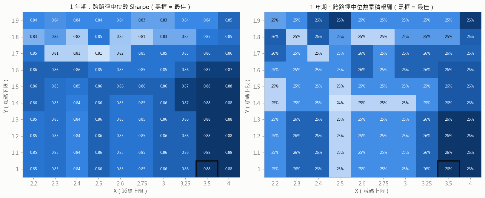

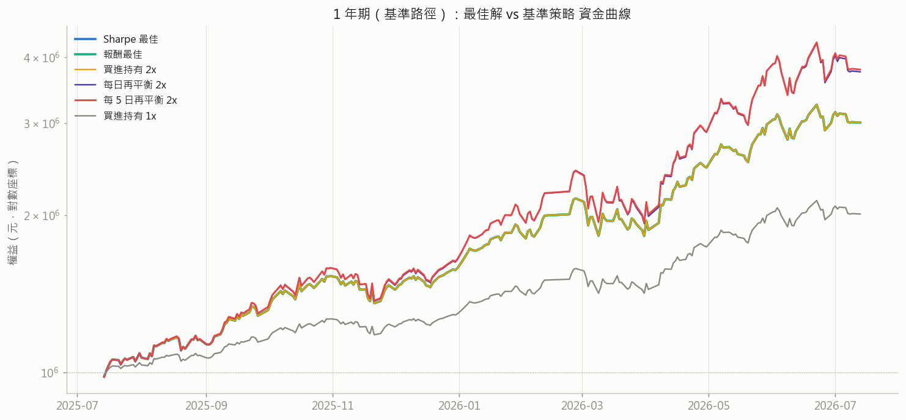

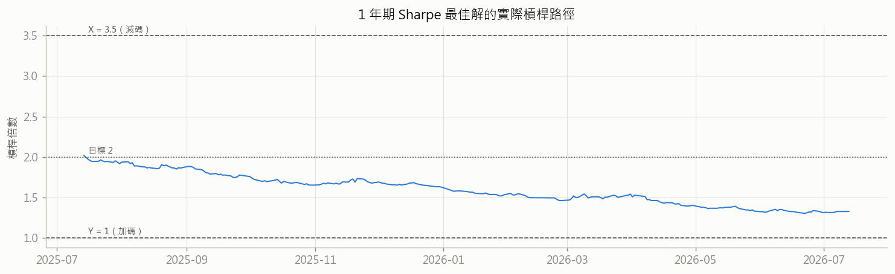

### 3 年期（101 條路徑；無參數組破產）

**跨路徑統計（最佳解判定依據）**

| 策略 | 中位數報酬 | 中位數Sharpe | Sharpe P25/P75 | 中位數MDD | 最差路徑報酬 | 勝率vs BH2x | 勝率vs 每日2x | 破產路徑 |
|---|---|---|---|---|---|---|---|---|
| 報酬最佳 [4, 1.9] | +79.5% | 0.679 | 0.42 / 0.93 | -53.6% | -93.6% | 79% | 73% | 0/101 |
| Sharpe最佳 [3.5, 1] | +70.5% | 0.703 | 0.41 / 0.98 | -44.8% | -88.7% | 12% | 41% | 0/101 |
| 買進持有 2x | +71.3% | 0.754 | 0.59 / 1.03 | -44.8% | -100.0% | 0% | 49% | 12/101 |
| 每日再平衡 2x（正2倍ETF） | +72.1% | 0.665 | 0.38 / 0.92 | -48.7% | -87.2% | 51% | 0% | 0/101 |
| **每 5 日再平衡 2x** | +72.9% | 0.668 | 0.38 / 0.90 | -48.5% | -87.3% | 53% | 56% | 0/101 |
| 買進持有 1x | +38.2% | 0.661 | 0.38 / 0.92 | -26.2% | -54.9% | 15% | 25% | 0/101 |

**基準路徑（終點＝資料最後一日）完整指標**

| 策略 | 累積報酬 | CAGR | 年化波動 | Sharpe | MDD | Calmar | Sortino | 加碼/減碼次數 | 成本/初始資本 | 平均槓桿 | 最高槓桿 | 最長水下(月) | 破產 |
|---|---|---|---|---|---|---|---|---|---|---|---|---|---|
| 報酬最佳 [4, 1.9] | +631.0% | +99.3% | +52.2% | 1.553 | -56.0% | 1.77 | 2.30 | 18/0 | +2.0% | 2.03 | 3.03 | 12.3 | 否 |
| Sharpe最佳 [3.5, 1] | +357.4% | +69.4% | +37.2% | 1.559 | -44.2% | 1.57 | 2.25 | 0/0 | +1.3% | 1.59 | 2.10 | 12.3 | 否 |
| 買進持有 2x | +357.4% | +69.4% | +37.2% | 1.559 | -44.2% | 1.57 | 2.25 | 0/0 | +1.3% | 1.59 | 2.10 | 12.3 | 否 |
| 每日再平衡 2x（正2倍ETF） | +560.1% | +92.4% | +48.0% | 1.572 | -53.7% | 1.72 | 2.26 | 414/313 | +2.1% | 2.00 | 2.25 | 13.4 | 否 |
| **每 5 日再平衡 2x** | +560.2% | +92.4% | +48.5% | 1.563 | -54.2% | 1.70 | 2.25 | 87/58 | +2.0% | 1.99 | 2.53 | 13.5 | 否 |
| 買進持有 1x | +181.2% | +43.1% | +23.5% | 1.571 | -28.6% | 1.51 | 2.26 | 0/0 | +0.7% | 0.98 | 1.00 | 12.1 | 否 |

**過擬合對照：中位數最佳 vs 單一路徑最佳**

| 準則 | 中位數最佳 | 其中位數值 | 其單路徑值 | 單路徑最佳 | 其單路徑值 | 其中位數值 |
|---|---|---|---|---|---|---|
| 累積報酬 | [4, 1.9] | +79.5% | +631.0% | [3.25, 1.9] | +631.0% | +72.4% |
| Sharpe | [3.5, 1] | 0.703 | 1.559 | [2.3, 1.5] | 1.644 | 0.669 |

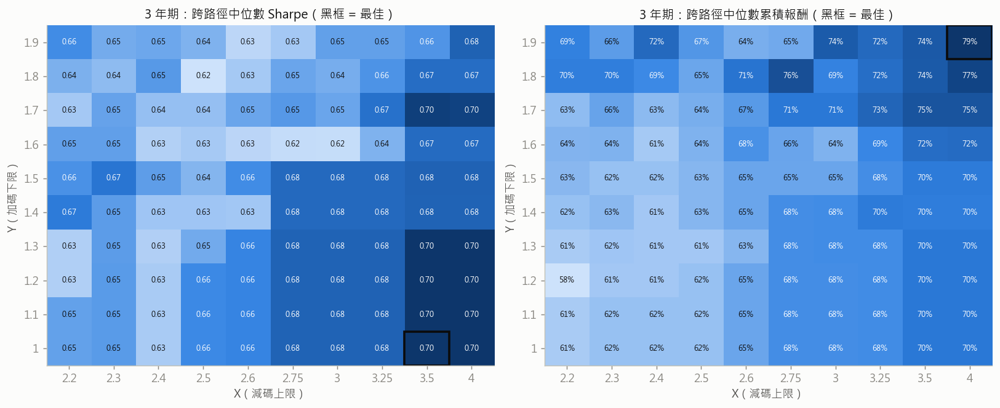

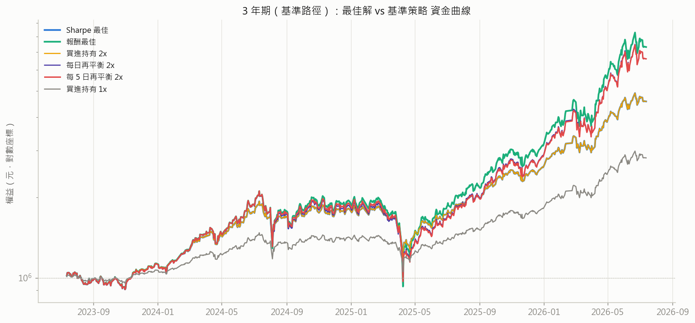

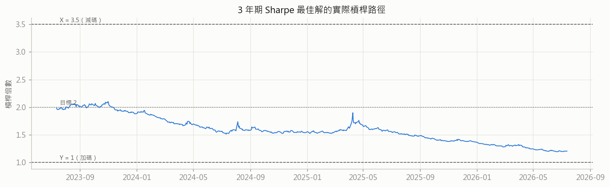

### 5 年期（93 條路徑；無參數組破產）

**跨路徑統計（最佳解判定依據）**

| 策略 | 中位數報酬 | 中位數Sharpe | Sharpe P25/P75 | 中位數MDD | 最差路徑報酬 | 勝率vs BH2x | 勝率vs 每日2x | 破產路徑 |
|---|---|---|---|---|---|---|---|---|
| 報酬最佳 [4, 1.9] | +153.7% | 0.677 | 0.41 / 0.91 | -60.2% | -86.8% | 73% | 69% | 0/93 |
| Sharpe最佳 [3.5, 1] | +139.9% | 0.695 | 0.33 / 0.93 | -49.8% | -77.6% | 13% | 27% | 0/93 |
| 買進持有 2x | +143.7% | 0.732 | 0.55 / 0.97 | -49.8% | -100.0% | 0% | 34% | 12/93 |
| 每日再平衡 2x（正2倍ETF） | +131.8% | 0.672 | 0.37 / 0.92 | -53.0% | -76.0% | 66% | 0% | 0/93 |
| **每 5 日再平衡 2x** | +134.0% | 0.676 | 0.37 / 0.92 | -54.8% | -75.7% | 68% | 54% | 0/93 |
| 買進持有 1x | +76.2% | 0.672 | 0.38 / 0.92 | -29.7% | -34.2% | 15% | 25% | 0/93 |

**基準路徑（終點＝資料最後一日）完整指標**

| 策略 | 累積報酬 | CAGR | 年化波動 | Sharpe | MDD | Calmar | Sortino | 加碼/減碼次數 | 成本/初始資本 | 平均槓桿 | 最高槓桿 | 最長水下(月) | 破產 |
|---|---|---|---|---|---|---|---|---|---|---|---|---|---|
| 報酬最佳 [4, 1.9] | +750.5% | +55.9% | +47.9% | 1.134 | -56.0% | 1.00 | 1.66 | 19/0 | +3.3% | 2.10 | 3.06 | 16.4 | 否 |
| Sharpe最佳 [3.5, 1] | +399.9% | +39.7% | +36.4% | 1.054 | -50.6% | 0.78 | 1.51 | 0/0 | +2.3% | 1.74 | 2.74 | 16.4 | 否 |
| 買進持有 2x | +399.9% | +39.7% | +36.4% | 1.054 | -50.6% | 0.78 | 1.51 | 0/0 | +2.3% | 1.74 | 2.74 | 16.4 | 否 |
| 每日再平衡 2x（正2倍ETF） | +630.7% | +51.1% | +43.3% | 1.133 | -53.7% | 0.95 | 1.62 | 669/545 | +3.2% | 2.00 | 2.25 | 17.4 | 否 |
| **每 5 日再平衡 2x** | +652.4% | +52.0% | +43.8% | 1.139 | -53.4% | 0.97 | 1.64 | 144/98 | +3.0% | 2.00 | 2.34 | 17.4 | 否 |
| 買進持有 1x | +204.2% | +26.0% | +21.0% | 1.126 | -28.1% | 0.93 | 1.61 | 0/0 | +1.1% | 0.97 | 1.00 | 16.2 | 否 |

**過擬合對照：中位數最佳 vs 單一路徑最佳**

| 準則 | 中位數最佳 | 其中位數值 | 其單路徑值 | 單路徑最佳 | 其單路徑值 | 其中位數值 |
|---|---|---|---|---|---|---|
| 累積報酬 | [4, 1.9] | +153.7% | +750.5% | [3.25, 1.9] | +750.5% | +149.3% |
| Sharpe | [3.5, 1] | 0.695 | 1.054 | [2.75, 1.8] | 1.154 | 0.639 |

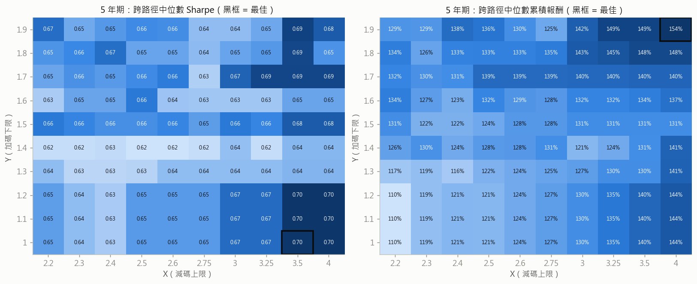

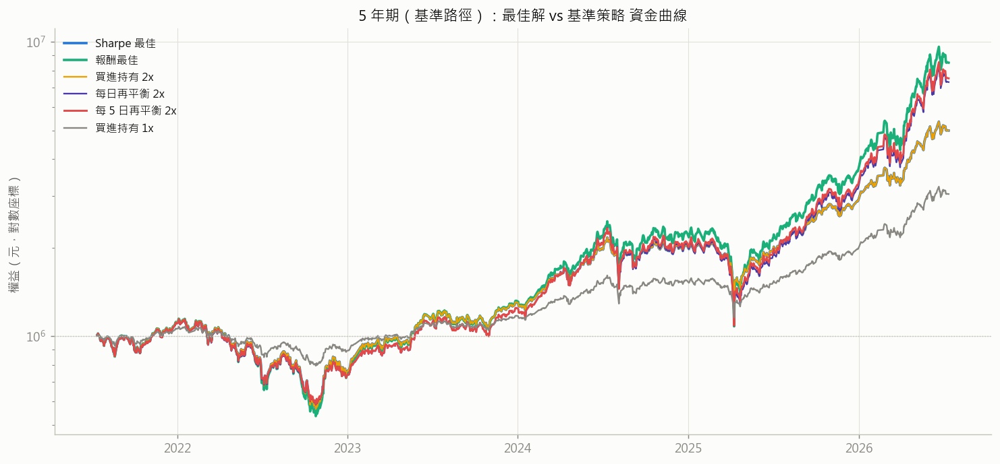

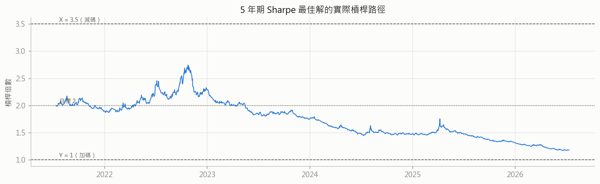

### 10 年期（73 條路徑；無參數組破產）

**跨路徑統計（最佳解判定依據）**

| 策略 | 中位數報酬 | 中位數Sharpe | Sharpe P25/P75 | 中位數MDD | 最差路徑報酬 | 勝率vs BH2x | 勝率vs 每日2x | 破產路徑 |
|---|---|---|---|---|---|---|---|---|
| 報酬最佳 [3.25, 1.9] | +391.3% | 0.540 | 0.46 / 0.80 | -88.2% | -81.0% | 71% | 60% | 0/73 |
| Sharpe最佳 [2.5, 1] | +310.5% | 0.560 | 0.39 / 0.84 | -68.4% | -53.7% | 16% | 29% | 0/73 |
| 買進持有 2x | +342.8% | 0.631 | 0.52 / 0.87 | -69.5% | -100.0% | 0% | 36% | 12/73 |
| 每日再平衡 2x（正2倍ETF） | +360.6% | 0.533 | 0.44 / 0.83 | -84.6% | -74.0% | 64% | 0% | 0/73 |
| **每 5 日再平衡 2x** | +361.9% | 0.531 | 0.44 / 0.84 | -84.5% | -74.7% | 68% | 48% | 0/73 |
| 買進持有 1x | +180.4% | 0.531 | 0.44 / 0.83 | -54.0% | -9.2% | 16% | 15% | 0/73 |

**基準路徑（終點＝資料最後一日）完整指標**

| 策略 | 累積報酬 | CAGR | 年化波動 | Sharpe | MDD | Calmar | Sortino | 加碼/減碼次數 | 成本/初始資本 | 平均槓桿 | 最高槓桿 | 最長水下(月) | 破產 |
|---|---|---|---|---|---|---|---|---|---|---|---|---|---|
| 報酬最佳 [3.25, 1.9] | +4951.9% | +50.0% | +41.6% | 1.145 | -59.7% | 0.84 | 1.64 | 42/1 | +25.3% | 2.05 | 3.34 | 16.4 | 否 |
| Sharpe最佳 [2.5, 1] | +1444.5% | +32.7% | +24.6% | 1.208 | -42.7% | 0.77 | 1.73 | 0/0 | +10.3% | 1.33 | 2.00 | 16.2 | 否 |
| 買進持有 2x | +1444.5% | +32.7% | +24.6% | 1.208 | -42.7% | 0.77 | 1.73 | 0/0 | +10.3% | 1.33 | 2.00 | 16.2 | 否 |
| 每日再平衡 2x（正2倍ETF） | +4774.2% | +49.5% | +38.5% | 1.194 | -53.7% | 0.92 | 1.70 | 1372/1065 | +27.7% | 2.00 | 2.25 | 17.4 | 否 |
| **每 5 日再平衡 2x** | +4776.4% | +49.5% | +39.0% | 1.185 | -54.5% | 0.91 | 1.69 | 287/200 | +26.2% | 2.00 | 2.53 | 17.0 | 否 |
| 買進持有 1x | +731.1% | +24.5% | +18.3% | 1.196 | -29.5% | 0.83 | 1.71 | 0/0 | +5.2% | 0.96 | 1.00 | 16.2 | 否 |

**過擬合對照：中位數最佳 vs 單一路徑最佳**

| 準則 | 中位數最佳 | 其中位數值 | 其單路徑值 | 單路徑最佳 | 其單路徑值 | 其中位數值 |
|---|---|---|---|---|---|---|
| 累積報酬 | [3.25, 1.9] | +391.3% | +4951.9% | [3.5, 1.9] | +6044.5% | +328.2% |
| Sharpe | [2.5, 1] | 0.560 | 1.208 | [2.75, 1.5] | 1.242 | 0.504 |

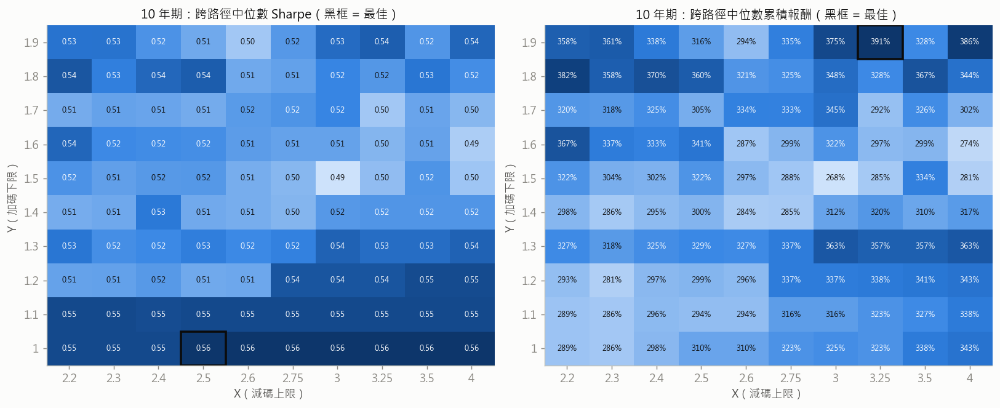

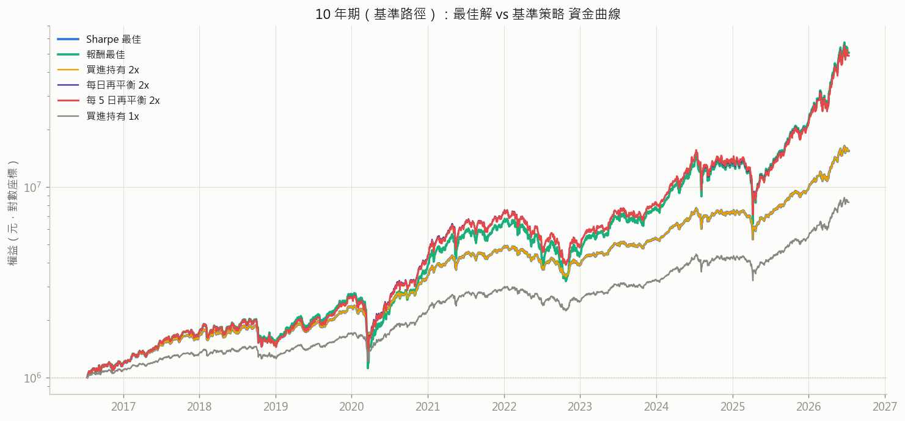

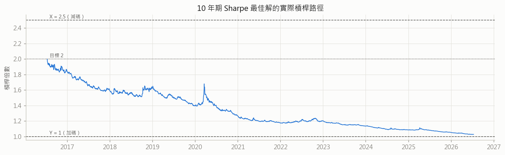

### 20 年期（33 條路徑；無參數組破產）

**跨路徑統計（最佳解判定依據）**

| 策略 | 中位數報酬 | 中位數Sharpe | Sharpe P25/P75 | 中位數MDD | 最差路徑報酬 | 勝率vs BH2x | 勝率vs 每日2x | 破產路徑 |
|---|---|---|---|---|---|---|---|---|
| 報酬最佳 [4, 1.9] | +4495.4% | 0.606 | 0.44 / 0.65 | -90.6% | +0.4% | 97% | 64% | 0/33 |
| Sharpe最佳 [3.25, 1.1] | +2424.7% | 0.616 | 0.43 / 0.66 | -79.5% | +17.1% | 82% | 3% | 0/33 |
| 買進持有 2x | +1630.0% | 0.602 | 0.55 / 0.62 | -80.1% | -100.0% | 0% | 3% | 8/33 |
| 每日再平衡 2x（正2倍ETF） | +3433.3% | 0.606 | 0.43 / 0.66 | -84.6% | +63.7% | 97% | 0% | 0/33 |
| **每 5 日再平衡 2x** | +3518.2% | 0.612 | 0.43 / 0.65 | -84.6% | +69.2% | 97% | 45% | 0/33 |
| 買進持有 1x | +834.5% | 0.599 | 0.42 / 0.65 | -55.1% | +142.3% | 24% | 21% | 0/33 |

**基準路徑（終點＝資料最後一日）完整指標**

| 策略 | 累積報酬 | CAGR | 年化波動 | Sharpe | MDD | Calmar | Sortino | 加碼/減碼次數 | 成本/初始資本 | 平均槓桿 | 最高槓桿 | 最長水下(月) | 破產 |
|---|---|---|---|---|---|---|---|---|---|---|---|---|---|
| 報酬最佳 [4, 1.9] | +23116.7% | +32.2% | +49.2% | 0.780 | -89.9% | 0.36 | 1.13 | 59/1 | +129.3% | 2.11 | 4.08 | 38.8 | 否 |
| Sharpe最佳 [3.25, 1.1] | +5010.9% | +22.3% | +33.4% | 0.722 | -83.1% | 0.27 | 1.02 | 2/1 | +36.6% | 1.40 | 3.60 | 78.5 | 否 |
| 買進持有 2x | +3564.3% | +20.3% | +33.5% | 0.668 | -83.6% | 0.24 | 0.96 | 0/0 | +35.4% | 1.28 | 3.79 | 26.0 | 否 |
| 每日再平衡 2x（正2倍ETF） | +16188.2% | +29.8% | +41.9% | 0.794 | -84.6% | 0.35 | 1.12 | 2732/2183 | +108.4% | 2.00 | 2.25 | 37.9 | 否 |
| **每 5 日再平衡 2x** | +17091.9% | +30.2% | +42.6% | 0.794 | -84.6% | 0.36 | 1.13 | 591/392 | +108.2% | 2.00 | 2.63 | 37.4 | 否 |
| 買進持有 1x | +1801.6% | +16.3% | +19.7% | 0.781 | -55.8% | 0.29 | 1.10 | 0/0 | +17.7% | 0.93 | 1.00 | 25.9 | 否 |

**過擬合對照：中位數最佳 vs 單一路徑最佳**

| 準則 | 中位數最佳 | 其中位數值 | 其單路徑值 | 單路徑最佳 | 其單路徑值 | 其中位數值 |
|---|---|---|---|---|---|---|
| 累積報酬 | [4, 1.9] | +4495.4% | +23116.7% | [4, 1.9] | +23116.7% | +4495.4% |
| Sharpe | [3.25, 1.1] | 0.616 | 0.722 | [2.3, 1.4] | 0.801 | 0.576 |

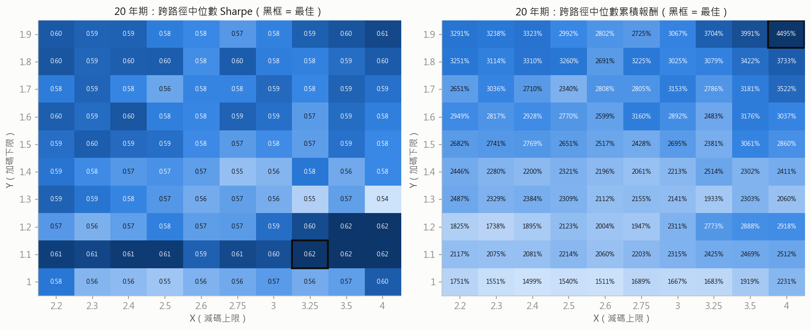

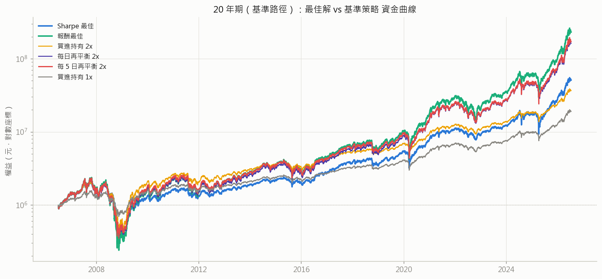

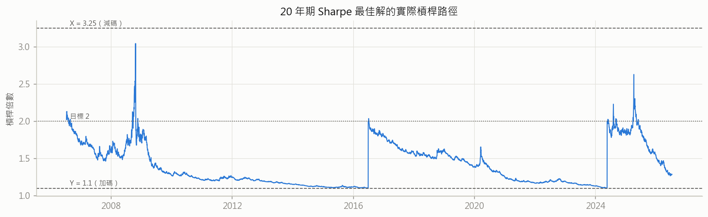

## 3. 熱力圖形態：參數平原或尖峰？

量化規則：取最佳格 3×3 鄰域，計算 **retention =（鄰域均值 − 全網格中位數）/（峰值 − 全網格中位數）**。
retention ≥ 0.6 且鄰域最小值不低於全網格中位數 → **平原**；retention < 0.3 → **尖峰**；其間 → 緩坡。

| 期間 | 準則 | 最佳格 | 峰值 | 鄰域均值 | 鄰域最小 | 網格中位數 | retention | 判定 |
|---|---|---|---|---|---|---|---|---|
| 1y | Sharpe | [3.5, 1] | 0.875 | 0.869 | 0.856 | 0.849 | 0.76 | **平原** |
| 1y | 報酬 | [3.5, 1] | +26.2% | +26.0% | +25.6% | +25.2% | 0.81 | **平原** |
| 3y | Sharpe | [3.5, 1] | 0.703 | 0.695 | 0.679 | 0.657 | 0.83 | **平原** |
| 3y | 報酬 | [4, 1.9] | +79.5% | +75.3% | +74.3% | +68.1% | 0.64 | **平原** |
| 5y | Sharpe | [3.5, 1] | 0.695 | 0.687 | 0.670 | 0.652 | 0.81 | **平原** |
| 5y | 報酬 | [4, 1.9] | +153.7% | +148.5% | +148.0% | +130.4% | 0.77 | **平原** |
| 10y | Sharpe | [2.5, 1] | 0.560 | 0.553 | 0.548 | 0.520 | 0.82 | **平原** |
| 10y | 報酬 | [3.25, 1.9] | +391.3% | +349.4% | +327.9% | +322.3% | 0.39 | **緩坡** |
| 20y | Sharpe | [3.25, 1.1] | 0.616 | 0.594 | 0.562 | 0.581 | 0.36 | **緩坡** |
| 20y | 報酬 | [4, 1.9] | +4495.4% | +3715.5% | +3422.3% | +2513.1% | 0.61 | **平原** |

## 4. 穩健性：20 年最佳解套用到其他期間

| 組合 | 期間 | 中位數報酬 | 中位數Sharpe | 最差路徑 | 勝率vs每日2x | Sharpe百分位 |
|---|---|---|---|---|---|---|
| [3.25, 1.1]（20y_Sharpe最佳） | 1y | +25.6% | 0.856 | -79.7% | 52% | 84% |
| [4, 1.9]（20y_報酬最佳） | 1y | +26.1% | 0.853 | -84.0% | 76% | 58% |
| [3.25, 1.1]（20y_Sharpe最佳） | 3y | +68.3% | 0.679 | -89.4% | 41% | 89% |
| [4, 1.9]（20y_報酬最佳） | 3y | +79.5% | 0.679 | -93.6% | 73% | 90% |
| [3.25, 1.1]（20y_Sharpe最佳） | 5y | +135.5% | 0.670 | -81.1% | 28% | 85% |
| [4, 1.9]（20y_報酬最佳） | 5y | +153.7% | 0.677 | -86.8% | 69% | 87% |
| [3.25, 1.1]（20y_Sharpe最佳） | 10y | +322.6% | 0.550 | -61.9% | 32% | 93% |
| [4, 1.9]（20y_報酬最佳） | 10y | +386.3% | 0.537 | -86.8% | 77% | 70% |
| [3.25, 1.1]（20y_Sharpe最佳） | 20y | +2424.7% | 0.616 | +17.1% | 3% | 100% |
| [4, 1.9]（20y_報酬最佳） | 20y | +4495.4% | 0.606 | +0.4% | 64% | 91% |

## 5. 對稱性檢驗：X 是否比 Y 更貼近 2.0？

幾何報酬 g(L) = r + Lα − L²σ²/2 對槓桿的懲罰是二次式：高於目標的槓桿（下跌後）比低於目標
（上漲後）更傷害複利，故理論預測**減碼上限 X 應比加碼下限 Y 更貼近 2.0**（|X−2| < |2−Y|）。實測：

| 期間 | Sharpe最佳 | dX = X−2 | dY = 2−Y | 理論預測 |
|---|---|---|---|---|
| 1y | [3.5, 1] | 1.50 | 1.00 | **不符合** |
| 3y | [3.5, 1] | 1.50 | 1.00 | **不符合** |
| 5y | [3.5, 1] | 1.50 | 1.00 | **不符合** |
| 10y | [2.5, 1] | 0.50 | 1.00 | 符合 |
| 20y | [3.25, 1.1] | 1.25 | 0.90 | **不符合** |

**結論：理論預測被實測推翻**（4/5 期間 dX > dY）。
解讀：(1) 觸及 X 需自上次再平衡點下跌約 25–30%，樣本中僅數次，且台股崩盤多呈 V 型——
跌深即減碼等於在低點賣出、錯過反彈，抵銷了二次懲罰理論上的好處；(2) 邊際曲線顯示
Sharpe 沿 X 幾乎平坦（見下），X 的位置本來就不是第一階因素，argmax 落點接近隨機；
(3) 台股長期正漂移使「高槓桿懲罰」被復甦補償。二次懲罰的邏輯在「無漂移、非 V 型」
的市場才會浮現，本樣本不屬之。

Sharpe 對 X、Y 的邊際結構（跨另一軸取中位數；看整體形狀而非單點）：

- **20y** 邊際中位數 Sharpe — 沿 X：2.2→0.591、2.3→0.590、2.4→0.584、2.5→0.581、2.6→0.576、2.75→0.570、3→0.580、3.25→0.579、3.5→0.589、4→0.592；沿 Y：1→0.563、1.1→0.612、1.2→0.575、1.3→0.568、1.4→0.572、1.5→0.582、1.6→0.588、1.7→0.580、1.8→0.594、1.9→0.594

- **10y** 邊際中位數 Sharpe — 沿 X：2.2→0.530、2.3→0.521、2.4→0.521、2.5→0.518、2.6→0.513、2.75→0.517、3→0.529、3.25→0.525、3.5→0.524、4→0.528；沿 Y：1→0.560、1.1→0.550、1.2→0.530、1.3→0.528、1.4→0.513、1.5→0.510、1.6→0.514、1.7→0.511、1.8→0.524、1.9→0.524

## 6. 敏感度分析

### 6.1 滑價 0.5 檔（原 1 檔）

| 期間 | 主情境最佳 | 低滑價最佳 | 同格 | 主情境Sharpe | 主最佳@低滑價 | 低滑價最佳Sharpe |
|---|---|---|---|---|---|---|
| 1y | [3.5, 1] | [3.5, 1] | 是 | 0.875 | 0.884 | 0.884 |
| 3y | [3.5, 1] | [3.5, 1] | 是 | 0.703 | 0.707 | 0.707 |
| 5y | [3.5, 1] | [3.5, 1] | 是 | 0.695 | 0.703 | 0.703 |
| 10y | [2.5, 1] | [2.4, 1] | 否 | 0.560 | 0.566 | 0.566 |
| 20y | [3.25, 1.1] | [3.25, 1.2] | 否 | 0.616 | 0.625 | 0.626 |

### 6.2 轉倉時點 offset 0（原 5）

| 期間 | 主情境最佳 | offset0最佳 | 同格 | 主情境Sharpe | 主最佳@offset0 | offset0最佳Sharpe |
|---|---|---|---|---|---|---|
| 1y | [3.5, 1] | [3.25, 1] | 否 | 0.875 | 0.919 | 0.919 |
| 3y | [3.5, 1] | [3.25, 1] | 否 | 0.703 | 0.734 | 0.734 |
| 5y | [3.5, 1] | [2.5, 1.6] | 否 | 0.695 | 0.717 | 0.738 |
| 10y | [2.5, 1] | [2.3, 1] | 否 | 0.560 | 0.616 | 0.616 |
| 20y | [3.25, 1.1] | [3.5, 1.2] | 否 | 0.616 | 0.654 | 0.677 |

註：offset=0（持有近月到最後交易日才換倉）在**所有期間**都使 Sharpe 略升——
與台指期長期逆價差一致：近月最後幾天仍在向現貨收斂，提早 5 天轉倉會少賺這段。
（近一年正價差 regime 下方向相反，參見月差分析專案。）最佳格雖有小幅漂移，
但仍在同一高原帶內，主結論不受轉倉時點影響。

### 6.3 二次精細搜尋（步長 0.05，以各期間 Sharpe 最佳為中心）

| 期間 | 粗網格最佳 | 其Sharpe | 精細最佳 | 其Sharpe |
|---|---|---|---|---|
| 1y | [3.5, 1] | 0.875 | [3.5, 0.85] | 0.875 |
| 3y | [3.5, 1] | 0.703 | [3.5, 0.85] | 0.703 |
| 5y | [3.5, 1] | 0.695 | [3.35, 0.85] | 0.695 |
| 10y | [2.5, 1] | 0.560 | [2.45, 0.85] | 0.560 |
| 20y | [3.25, 1.1] | 0.616 | [3.05, 1.1] | 0.616 |

註：精細搜尋的鄰域容許 Y 低於原網格下緣（至 0.8）。精細最佳與粗網格最佳的
Sharpe 差異皆 < 0.01——曲面在最佳格附近近乎水平，更細的步長不改變任何結論
（Y ≤ 1.0 的「最佳」與 Y = 1.0 實為同一策略：該視窗內都不曾觸發加碼）。

## 6.4 再平衡頻率掃描（含新增的「每 5 日再平衡」策略）

此節把「再平衡頻率」當成獨立維度掃描：從永不再平衡（買進持有 2x）、
每季（63 日）、每月（21 日）、每雙週（10 日）、**每 5 日**、到每日（＝正 2 倍 ETF 的標準機制）。
所有策略皆為初始 2 倍、無門檻，僅到期就無條件把槓桿調回 2.0。

**1 年期**（前 6 欄＝跨路徑中位數統計；後 6 欄＝基準路徑）

| 再平衡頻率 | 中位數報酬 | 中位數CAGR | 中位數Sharpe | 中位數MDD | 最差路徑 | 破產路徑 | 基準總報酬 | 基準MDD | 基準水下(月) | 再平衡次數 | 成本/初始資本 | 平均槓桿 |
|---|---|---|---|---|---|---|---|---|---|---|---|---|
| 永不（買進持有） | +26.2% | +26.9% | 0.888 | -30.7% | -100.0% | 3/109 | +200.4% | -15.2% | 1.8 | 0 | +0.4% | 1.60 |
| 每 63 日（季） | +25.5% | +26.3% | 0.847 | -31.7% | -79.1% | 0/109 | +260.6% | -18.5% | 1.8 | 3 | +0.5% | 1.87 |
| 每 21 日（月） | +25.1% | +25.4% | 0.814 | -34.0% | -77.0% | 0/109 | +273.7% | -19.8% | 1.4 | 11 | +0.5% | 1.95 |
| 每 10 日（雙週） | +24.4% | +25.1% | 0.812 | -32.9% | -77.5% | 0/109 | +279.2% | -20.7% | 1.8 | 24 | +0.5% | 1.98 |
| 每 5 日 ★新增 | +24.1% | +24.6% | 0.819 | -32.9% | -77.6% | 0/109 | +279.5% | -20.2% | 1.8 | 48 | +0.5% | 1.99 |
| 每 1 日（正2倍ETF） | +24.2% | +24.7% | 0.808 | -32.3% | -76.6% | 0/109 | +275.7% | -20.9% | 1.8 | 242 | +0.6% | 2.00 |

**3 年期**（前 6 欄＝跨路徑中位數統計；後 6 欄＝基準路徑）

| 再平衡頻率 | 中位數報酬 | 中位數CAGR | 中位數Sharpe | 中位數MDD | 最差路徑 | 破產路徑 | 基準總報酬 | 基準MDD | 基準水下(月) | 再平衡次數 | 成本/初始資本 | 平均槓桿 |
|---|---|---|---|---|---|---|---|---|---|---|---|---|
| 永不（買進持有） | +71.3% | +20.1% | 0.754 | -44.8% | -100.0% | 12/101 | +357.4% | -44.2% | 12.3 | 0 | +1.3% | 1.59 |
| 每 63 日（季） | +74.6% | +21.1% | 0.666 | -48.7% | -88.2% | 0/101 | +561.3% | -55.5% | 12.3 | 11 | +1.9% | 1.94 |
| 每 21 日（月） | +74.3% | +20.9% | 0.672 | -48.8% | -86.3% | 0/101 | +522.1% | -55.2% | 13.6 | 34 | +1.9% | 1.97 |
| 每 10 日（雙週） | +71.8% | +20.4% | 0.665 | -48.5% | -87.6% | 0/101 | +526.0% | -56.0% | 13.6 | 72 | +1.9% | 1.99 |
| 每 5 日 ★新增 | +72.9% | +20.3% | 0.668 | -48.5% | -87.3% | 0/101 | +560.2% | -54.2% | 13.5 | 145 | +2.0% | 1.99 |
| 每 1 日（正2倍ETF） | +72.1% | +20.4% | 0.665 | -48.7% | -87.2% | 0/101 | +560.1% | -53.7% | 13.4 | 727 | +2.1% | 2.00 |

**5 年期**（前 6 欄＝跨路徑中位數統計；後 6 欄＝基準路徑）

| 再平衡頻率 | 中位數報酬 | 中位數CAGR | 中位數Sharpe | 中位數MDD | 最差路徑 | 破產路徑 | 基準總報酬 | 基準MDD | 基準水下(月) | 再平衡次數 | 成本/初始資本 | 平均槓桿 |
|---|---|---|---|---|---|---|---|---|---|---|---|---|
| 永不（買進持有） | +143.7% | +20.0% | 0.732 | -49.8% | -100.0% | 12/93 | +399.9% | -50.6% | 16.4 | 0 | +2.3% | 1.74 |
| 每 63 日（季） | +139.5% | +19.4% | 0.676 | -59.4% | -78.0% | 0/93 | +609.3% | -54.8% | 21.2 | 19 | +2.8% | 1.95 |
| 每 21 日（月） | +131.1% | +18.7% | 0.680 | -57.9% | -73.7% | 0/93 | +681.3% | -53.9% | 17.4 | 57 | +3.0% | 1.99 |
| 每 10 日（雙週） | +140.8% | +19.5% | 0.662 | -56.3% | -77.8% | 0/93 | +668.8% | -55.2% | 17.4 | 121 | +3.0% | 1.99 |
| 每 5 日 ★新增 | +134.0% | +18.8% | 0.676 | -54.8% | -75.7% | 0/93 | +652.4% | -53.4% | 17.4 | 242 | +3.0% | 2.00 |
| 每 1 日（正2倍ETF） | +131.8% | +18.9% | 0.672 | -53.0% | -76.0% | 0/93 | +630.7% | -53.7% | 17.4 | 1,214 | +3.2% | 2.00 |

**10 年期**（前 6 欄＝跨路徑中位數統計；後 6 欄＝基準路徑）

| 再平衡頻率 | 中位數報酬 | 中位數CAGR | 中位數Sharpe | 中位數MDD | 最差路徑 | 破產路徑 | 基準總報酬 | 基準MDD | 基準水下(月) | 再平衡次數 | 成本/初始資本 | 平均槓桿 |
|---|---|---|---|---|---|---|---|---|---|---|---|---|
| 永不（買進持有） | +342.8% | +16.3% | 0.631 | -69.5% | -100.0% | 12/73 | +1444.5% | -42.7% | 16.2 | 0 | +10.3% | 1.33 |
| 每 63 日（季） | +281.3% | +14.5% | 0.491 | -86.4% | -72.3% | 0/73 | +4749.4% | -59.6% | 16.4 | 38 | +25.6% | 1.97 |
| 每 21 日（月） | +357.1% | +16.6% | 0.524 | -84.7% | -73.3% | 0/73 | +4444.3% | -59.7% | 17.9 | 116 | +24.0% | 1.99 |
| 每 10 日（雙週） | +373.9% | +17.1% | 0.538 | -84.1% | -76.0% | 0/73 | +4511.8% | -56.0% | 17.4 | 243 | +25.6% | 1.99 |
| 每 5 日 ★新增 | +361.9% | +16.8% | 0.531 | -84.5% | -74.7% | 0/73 | +4776.4% | -54.5% | 17.0 | 487 | +26.2% | 2.00 |
| 每 1 日（正2倍ETF） | +360.6% | +16.8% | 0.533 | -84.6% | -74.0% | 0/73 | +4774.2% | -53.7% | 17.4 | 2,437 | +27.7% | 2.00 |

**20 年期**（前 6 欄＝跨路徑中位數統計；後 6 欄＝基準路徑）

| 再平衡頻率 | 中位數報酬 | 中位數CAGR | 中位數Sharpe | 中位數MDD | 最差路徑 | 破產路徑 | 基準總報酬 | 基準MDD | 基準水下(月) | 再平衡次數 | 成本/初始資本 | 平均槓桿 |
|---|---|---|---|---|---|---|---|---|---|---|---|---|
| 永不（買進持有） | +1630.0% | +15.7% | 0.602 | -80.1% | -100.0% | 8/33 | +3564.3% | -83.6% | 26.0 | 0 | +35.4% | 1.28 |
| 每 63 日（季） | +2524.0% | +18.2% | 0.555 | -91.9% | +20.6% | 0/33 | +11877.3% | -89.3% | 78.2 | 78 | +72.9% | 1.99 |
| 每 21 日（月） | +3486.6% | +20.0% | 0.604 | -86.3% | +63.7% | 0/33 | +14659.3% | -85.5% | 69.8 | 234 | +92.3% | 1.99 |
| 每 10 日（雙週） | +3654.7% | +20.3% | 0.608 | -84.6% | +76.6% | 0/33 | +16030.4% | -84.6% | 37.1 | 491 | +102.7% | 2.00 |
| 每 5 日 ★新增 | +3518.2% | +20.1% | 0.612 | -84.6% | +69.2% | 0/33 | +17091.9% | -84.6% | 37.4 | 983 | +108.2% | 2.00 |
| 每 1 日（正2倍ETF） | +3433.3% | +20.0% | 0.606 | -84.6% | +63.7% | 0/33 | +16188.2% | -84.6% | 37.9 | 4,915 | +108.4% | 2.00 |

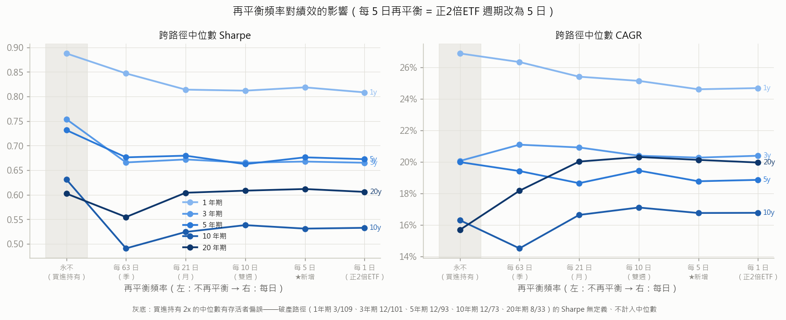

**相位敏感度**：「每 5 日」的週期自建倉日起算，換個起跑日（相位 0–4）結果會變。滾動起點路徑本已隨機化相位（每條各自從其建倉日算起），故上表中位數已整合過相位；下表量化單一基準路徑上的相位擴散：

| 期間 | 總報酬（相位 0–4 全距） | Sharpe 全距 | MDD 全距 | 報酬變異係數 |
|---|---|---|---|---|
| 1y | +273.3% ～ +279.5% | 2.893 ～ 2.924 | -20.9% ～ -20.1% | +0.8% |
| 3y | +546.2% ～ +582.5% | 1.549 ～ 1.578 | -54.9% ～ -53.4% | +2.9% |
| 5y | +617.6% ～ +655.7% | 1.120 ～ 1.139 | -54.9% ～ -53.4% | +2.5% |
| 10y | +4606.1% ～ +4928.8% | 1.172 ～ 1.189 | -55.3% ～ -54.5% | +2.8% |
| 20y | +15489.7% ～ +18051.6% | 0.785 ～ 0.802 | -85.6% ～ -84.5% | +6.9% |

**這節怎麼讀（新增策略的評價）**

1. **「5 日再平衡」與「每日再平衡」幾乎沒有差別。** 兩者的中位數 Sharpe 差距
   1y +0.010、3y +0.002、5y +0.004、10y -0.002、20y +0.006
   ——4/5 個期間 5 日略勝，但幅度全在 ±0.02 以內，
   遠小於路徑間的離散度（P25–P75 跨距約 0.5）。**把正 2 倍 ETF 的再平衡週期從 1 日拉長到 5 日，
   對風險調整後績效沒有可辨識的影響。**
2. **省下的是成本，但成本本來就不是瓶頸。** 再平衡次數從
   4,915 次（每日）降到 983 次（5 日）——少了 80%，
   但 20 年期總成本只從初始資本的 108.4% 降到 108.2%。
   原因是**每月轉倉成本佔了絕大部分**，再平衡本身很便宜（名目調整量小、期交稅只有十萬分之二）。
3. **平均槓桿都被鎖在 2.00。** 5 日、10 日、每日的時間加權平均槓桿皆為 2.00（20 年期），
   代表 5 日的週期已足夠短到讓槓桿無法漂離目標——這也解釋了為何績效與每日幾乎相同。
   要看到「再平衡頻率」真正產生差異，得拉到季（63 日）以上：那時平均槓桿仍是 1.99，
   但中位數 Sharpe 掉到 0.555（20 年期），
   MDD 也明顯惡化。
4. **真正的分水嶺在「有沒有再平衡」，而不是「多久再平衡一次」。**
   買進持有 2x 的中位數 Sharpe 看起來最高（1y 0.888、3y 0.754、5y 0.732、10y 0.631、20y 0.602），
   **但那是存活者偏誤**：它在 1/5/10/20 年期分別有
   3/109、12/93、12/73、8/33 條路徑**破產歸零**，
   破產路徑的 Sharpe 無定義（記 NaN）而被排除在中位數之外。看「最差路徑報酬」欄就露餡了：
   買進持有 2x 全期間都是 **−100%**，所有週期再平衡策略則無一破產。
   **週期再平衡的價值不在提升報酬，而在把「歸零」這條尾巴切掉。**
5. **相位（起跑日）幾乎無關緊要**：20 年期換相位造成的總報酬差距約
   +16.4%、
   Sharpe 差 0.017。
   實務上不需要挑「週幾再平衡」。

## 7. 跨期間穩健組合（maximin 排名）

對每組 [X,Y] 計算其中位數 Sharpe 在各期間的百分位排名，取**五個期間中最差的排名**
（maximin：不求任一期間最好，只求每一期間都不差），排除任何期間有破產路徑者。前 10 名：

| 組合 | 最差期間排名 | 平均排名 |
|---|---|---|
| [3.5, 1.1] | 88% | 95% |
| [4, 1.1] | 88% | 95% |
| [4, 1] | 82% | 94% |
| [4, 1.2] | 80% | 93% |
| [3.5, 1.2] | 80% | 93% |
| [3.25, 1.1] | 72% | 85% |
| [3, 1.1] | 72% | 82% |
| [3.25, 1.2] | 72% | 81% |
| [3, 1.2] | 62% | 74% |
| [4, 1.9] | 58% | 79% |

## 8. 結論（規格 §10 六問）

### 8.1 報酬最高與 Sharpe 最高是否同一組？
不是（4/5 期間不同：3y、5y、10y、20y）。
兩準則選出**結構相反**的組合：

- **報酬準則**選「快加碼、永不減碼」（Y 貼近 2、X 貼著網格上緣）：漲 5–6% 就把槓桿補回 2、
  跌再深也不砍。這使時間加權平均槓桿維持在 2 以上（基準路徑
  3y=2.03、5y=2.10、10y=2.05、20y=2.11），
  在正漂移市場自然累積最多報酬——**它贏在「更多曝險」，不是門檻結構本身**。
  且 3y、5y、10y、20y 的報酬最佳落在**網格邊緣／角落 [4, 1.9] 一帶**，
  暗示無約束最適解在網格之外（X→∞、Y→2），即「槓桿越貼近上緣越好」的單調方向，並非內部最適。
- **Sharpe 準則**選「慢加碼、慢減碼」（Y ≈ 1.0–1.2、X ≥ 2.5）：平時幾乎不動作，
  平均槓桿反而低於 2（3y=1.59、5y=1.74、10y=1.33、20y=1.40），
  行為近似「買進持有＋崩盤保險絲」。（1y 例外：兩準則選到同一組，該期間多數路徑
  從未觸發門檻，網格排名幾乎全由噪音決定。）

差異來源：報酬準則不懲罰高槓桿帶來的波動與深回撤（中位數 MDD 差 10–20 個百分點），
Sharpe 準則會。這是**風險偏好之別**，不是其中一個「算錯」。

### 8.2 最佳解是平原還是尖峰？
各期間（Sharpe 準則）判定：1y=平原、3y=平原、5y=平原、10y=平原、20y=緩坡。
**沒有任何期間呈孤立尖峰**，最佳解可信度的主要威脅不是尖峰，而是整面曲面的平坦：
全網格中位數 Sharpe 的極差（最好格 − 最差格）僅
1y=0.07、3y=0.08、5y=0.07、10y=0.07、20y=0.08——
門檻放在合理範圍內的**任何位置，風險調整後績效差異都很小**。
其中 20y 判定為緩坡：最佳格坐在沿 Y 的窄脊上（如 20y 的 Y=1.1 帶），脊與鄰列的差距 ~0.04 Sharpe，在 33 條高度重疊路徑下應視為噪音，不足以宣稱 Y=1.1 優於 Y=1.0 或 1.2。
§6.3 精細搜尋（步長 0.05）亦顯示 Sharpe 對參數移動幾乎無感（差異 < 0.01），佐證平坦。
**實務結論：從高原帶挑選即可，單一格的名次沒有意義。**

### 8.3 隨期間拉長，最佳 [X, Y] 是否收斂？
Sharpe 準則最佳序列：1y→[3.5, 1]，3y→[3.5, 1]，5y→[3.5, 1]，10y→[2.5, 1]，20y→[3.25, 1.1]。單看 argmax 沒有明顯單調收斂
（10y 的 X=2.5 是含 2008 視窗比例最高的期間，崩盤中「早一點減碼」相對有利；其餘期間 X 落在 3.25–3.5）。
但**穩定收斂的是結構而非單點**：所有期間的 Sharpe 高原都位於 **Y ∈ [1.0, 1.2]（慢加碼）**，
且沿 X 平坦（X 位置次要）。§7 maximin 前 8 名全數落在 X ∈ [3, 4]、Y ∈ [1.0, 1.2]，
即隨檢驗趨嚴，答案收斂到「近似買進持有、僅保留崩盤減碼保險絲」的組態。

### 8.4 交易成本對最佳門檻寬度的影響
方向符合理論（成本越低、最佳區間可以越窄），但幅度只有一格、且僅部分期間可見：
滑價 1 → 0.5 檔後，10y 最佳由 [2.5, 1] 移至 [2.4, 1]、20y 最佳由 [3.25, 1.1] 移至 [3.25, 1.2]，
其餘期間最佳格不動。原因是此策略的觸發本來就極稀
（推薦組合在 20 年基準路徑上僅再平衡 3 次），總成本由**每月轉倉**主導、再平衡成本是零頭，
成本參數對門檻寬度只有二階影響。

§6.4 的頻率掃描給了同一結論的另一個切面：即使把再平衡次數從
4,915 次（每日）壓到 983 次（每 5 日），
20 年期總成本也只從初始資本的 108.4% 降到 108.2%——
**再平衡頻率不是成本的主要來源，轉倉才是。** 這也意味著「用寬門檻省交易成本」
的動機在台指期上其實很弱；門檻的真正價值是控制槓桿漂移與尾部風險，不是省手續費。

### 8.5 實務建議
推薦 **[X = 3.5, Y = 1.1]**（§7 maximin 第一名：最差期間排名 88%、
平均排名 95%；[4, 1.1] 並列，同帶皆可）。依據：

- 1y：中位數報酬 +26.2%、Sharpe 0.88、最差路徑 -81.7%；3y：中位數報酬 +70.5%、Sharpe 0.70、最差路徑 -88.7%；5y：中位數報酬 +139.9%、Sharpe 0.70、最差路徑 -77.6%；10y：中位數報酬 +327.4%、Sharpe 0.55、最差路徑 -56.1%；20y：中位數報酬 +2469.1%、Sharpe 0.62、最差路徑 +44.0%。所有期間、所有滾動路徑皆無破產，
  低滑價與 offset=0 敏感度情境下仍居各期間前段。
- 它位於每個期間熱力圖的高原帶內，不依賴任何單一期間的峰值格（規格 §11 反過擬合原則）。
- 白話翻譯這組參數的實際行為：自上次再平衡點**下跌約 30%** 才觸發減碼（保險絲），
  **上漲約 4.5 倍**才觸發加碼（幾乎不加碼）；平時就是 2 倍買進持有。
  它贏過每日再平衡的機制是省下持續「追高殺低」的再平衡損耗，輸給報酬最佳組的部分
  則是少了持續拉滿的曝險——這正是 Sharpe 與報酬兩準則的取捨位置。

### 8.6 誠實揭露
- **樣本獨立性**：資料 1998-07-22～2026-07-13 約 27.9 年，僅含約 1 個完整多空循環
  （2008 金融海嘯、2020 疫情崩跌、2022 修正、2024-2025 多頭）。20y 僅 33 條
  季頻路徑且**高度重疊**（實質獨立樣本 ≈ 1.4 條），其結論是「這 20 年的歷史敘述」而非
  對未來的統計推論。
- **1 年期**：109 條路徑但每條只含單一 regime，最佳 [X,Y] 幾乎純粹反映該年行情方向，
  **不提供 1 年期的參數建議**。
- **利率簡化**：閒置現金利率固定 1.7%，未反映 27 年間實際短率起伏；
  此假設影響所有策略的絕對數字，但對 [X,Y] 相對排序影響甚微。
- **BH 2x 的中位數 Sharpe 有存活者偏誤**：破產路徑的 Sharpe 無法定義（記 NaN），
  其「中位數 Sharpe」只反映存活路徑；請一併看破產路徑數欄位。
- 未模擬保證金追繳／強制平倉與資金顆粒度（依規格）；實盤中破產前就會先被斷頭，
  高槓桿組合的實際下檔比表列更糟。
